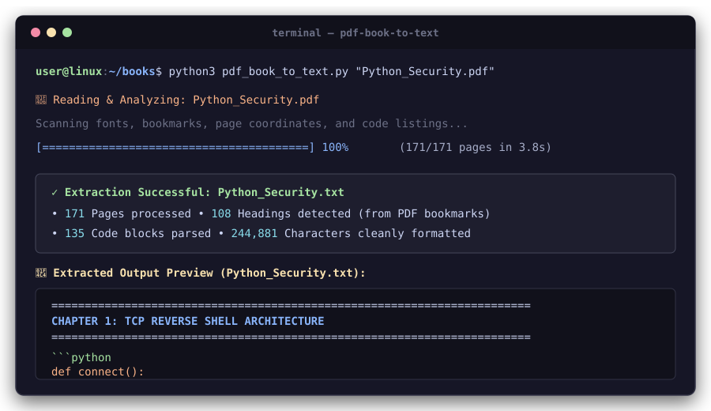
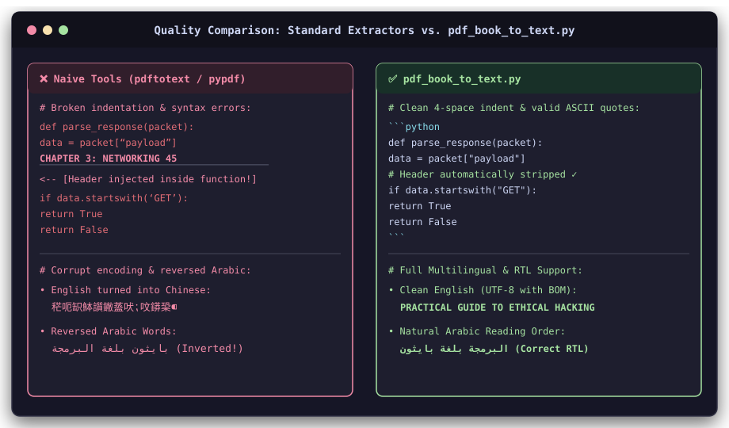
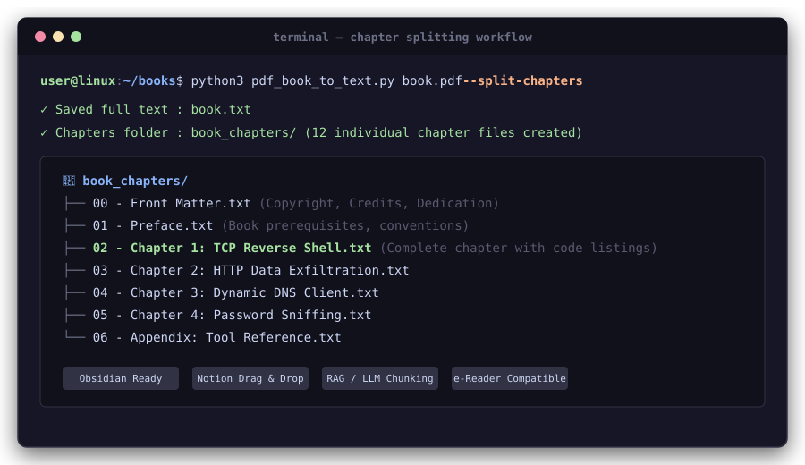

# Complete User & Developer Guide

This guide provides in-depth instructions, advanced recipes, programmatic Python integration, and technical explanations for [`pdf-book-to-text`](pdf_book_to_text.py) v2.0.

---

## Table of Contents

1. [Installation & Setup](#1-installation--setup)
2. [Visual Screenshots & CLI Walkthrough](#2-visual-screenshots--cli-walkthrough)
3. [CLI Workflows & Advanced Examples](#3-cli-workflows--advanced-examples)
   * [Standard Plain Text Extraction](#standard-plain-text-extraction)
   * [Direct Markdown Export (`--format md`)](#direct-markdown-export---format-md)
   * [RAG JSONL Chunks (`--format jsonl`)](#rag-jsonl-chunks---format-jsonl)
   * [High-Speed Parallel Processing (`-j N`)](#high-speed-parallel-processing--j-n)
   * [Chapter Splitting](#chapter-splitting)
   * [Multi-Column Layouts](#multi-column-layouts)
   * [Tables & Footnotes](#tables--footnotes)
   * [Scanned Books & OCR](#scanned-books--ocr)
4. [Python API (Programmatic Usage)](#4-python-api-programmatic-usage)
5. [Integration Guides](#5-integration-guides)
   * [Direct Ingestion into LangChain & LlamaIndex](#direct-ingestion-into-langchain--llamaindex)
   * [Direct Import into Obsidian & Notion](#direct-import-into-obsidian--notion)
6. [Under the Hood: Technical Architecture](#6-under-the-hood-technical-architecture)
   * [Mathematical Monospace & Proportional Code Detection](#mathematical-monospace--proportional-code-detection)
   * [Margin-Band Header Filtering & Footnote Relocation](#margin-band-header-filtering--footnote-relocation)
   * [Dynamic Vocabulary De-Hyphenation](#dynamic-vocabulary-de-hyphenation)
   * [Arabic & RTL BiDi Text Processing](#arabic--rtl-bidi-text-processing)
7. [Troubleshooting & Edge Cases](#7-troubleshooting--edge-cases)

---

## 1. Installation & Setup

### Requirements
* **Python**: 3.9 or later
* **PyMuPDF**: `>= 1.24.0`
* **Tesseract OCR** *(Optional, only needed if using `--ocr` on image-only scanned books)*:
  * Ubuntu/Debian: `sudo apt install tesseract-ocr`
  * macOS: `brew install tesseract`
  * Windows: [UB-Mannheim Tesseract installer](https://github.com/UB-Mannheim/tesseract/wiki)

### Recommended Environment Setup

```bash
# Clone the repository
git clone https://github.com/7AZZANI/pdf-book-to-text.git
cd pdf-book-to-text

# Create and activate virtual environment
python3 -m venv .venv
source .venv/bin/activate  # On Windows: .venv\Scripts\activate

# Install in editable mode
pip install -e .
```

After installation, the CLI tool `pdf-book-to-text` is directly available in your terminal.

---

## 2. Visual Screenshots & CLI Walkthrough

### Terminal Walkthrough

<p align="center">
  
</p>

### Code Extraction Quality (Before vs. After)

<p align="center">
  
</p>

### Automated Chapter Splitting

<p align="center">
  
</p>

---

## 3. CLI Workflows & Advanced Examples

### Standard Plain Text Extraction
```bash
pdf-book-to-text book.pdf
# Creates book.txt next to the PDF with clean ===== and ----- chapter headings
```

### Direct Markdown Export (`--format md`)
Produces GitHub-flavored Markdown with tagged code fences and `#` headings:
```bash
pdf-book-to-text book.pdf --format md -o book.md
```
* Fenced code blocks automatically receive language tags (```` ```python ````, ```` ```bash ````, ```` ```sql ````).
* Leading listing line numbers (`1  import os`) are automatically stripped.
* Box-drawing characters (`├──`, `└──`) and HTML entities (`&lt;div&gt;`) are preserved intact.

### RAG JSONL Chunks (`--format jsonl`)
Produces a stream of JSON records with full hierarchy and token counts:
```bash
pdf-book-to-text book.pdf --format jsonl -o book.jsonl
```
Each line contains:
```json
{
  "id": "book_00042",
  "book": "Python for Offensive PenTest",
  "type": "code",
  "language": "python",
  "text": "import socket\ns = socket.socket()",
  "chapter": "Chapter 1: Network Reconnaissance",
  "section": "1.2 TCP Sockets",
  "char_count": 35,
  "token_estimate": 7
}
```

### High-Speed Parallel Processing (`-j N`)
Process entire directories simultaneously using multiple CPU cores:
```bash
pdf-book-to-text ~/Books/ -r -j 4 --format md -o ~/MarkdownBooks/ --skip-existing
```
* `-j 4`: Distributes books across 4 worker processes.
* `--skip-existing`: Automatically skips files that have already been converted.
* Recreates the folder structure of your input library inside the output directory.

### Chapter Splitting
Extracts the main book and individual chapter files:
```bash
pdf-book-to-text book.pdf --format md --split-chapters
```
Outputs into `<book>_chapters/`:
```text
book_chapters/
  ├── 00_frontmatter.md
  ├── 01_preface.md
  ├── 02_chapter_1_the_way_of_the_program.md
  ├── 03_chapter_2_variables_and_expressions.md
  └── ...
```

### Multi-Column Layouts
* `--columns auto` *(Default)*: Automatically scans each page for a vertical gutter and determines reading order.
* `--columns 1`: Forces single-column mode.
* `--columns 2`: Forces two-column reading order (left-to-right for LTR, right-to-left for RTL):
  ```bash
  pdf-book-to-text two_column_manual.pdf --columns 2
  ```

### Tables & Footnotes
* `--tables`: Detects ruled tables and formats them as bordered ASCII or Markdown tables.
* `--footnotes section`: Collects small notes from the bottom of pages and relocates them to the end of sections.
* `--footnotes drop`: Strips footnotes if you only want uninterrupted body text.

### Scanned Books & OCR
```bash
pdf-book-to-text scanned_book.pdf --ocr --ocr-lang eng+ara
```
Automatically invokes Tesseract OCR on any page that contains only raster images.

---

## 4. Python API (Programmatic Usage)

You can import and use `BookExtractor` directly inside your Python applications:

```python
from pathlib import Path
from pdf_book_to_text import BookExtractor, Options, split_by_chapters

# Configure extraction settings
opts = Options(
    format="md",            # "txt", "md", or "jsonl"
    width=100,              # Wrap width (0 for no wrapping)
    detect_lang=True,       # Auto-detect language for code blocks
    strip_line_numbers=True,# Strip leading listing line numbers
    footnotes="section",    # "section", "inline", or "drop"
    quiet=False             # Show progress
)

# Initialize and run extractor
extractor = BookExtractor(Path("my_book.pdf"), opts)
elements = extractor.run()

# Render complete document
output_text = extractor.render(elements)
print(f"Rendered {len(output_text):,} characters")

# Access individual chapters programmatically
for chapter_slug, chapter_elements in split_by_chapters(extractor, elements):
    chapter_text = extractor.render(chapter_elements, include_header=False)
    print(f"Chapter: {chapter_slug} ({len(chapter_text):,} chars)")
```

---

## 5. Integration Guides

### Direct Ingestion into LangChain & LlamaIndex

```python
from pathlib import Path
import json
from pdf_book_to_text import BookExtractor, Options
from langchain_core.documents import Document

def load_pdf_book_rag(pdf_path: str) -> list[Document]:
    # Extract directly to JSONL RAG chunks
    opts = Options(format="jsonl", quiet=True)
    extractor = BookExtractor(Path(pdf_path), opts)
    elements = extractor.run()
    jsonl_output = extractor.render_jsonl(elements)

    docs = []
    for line in jsonl_output.strip().splitlines():
        if not line.strip():
            continue
        record = json.loads(line)
        docs.append(Document(
            page_content=record["text"],
            metadata={
                "source": pdf_path,
                "book": record["book"],
                "type": record["type"],
                "chapter": record.get("chapter", ""),
                "section": record.get("section", ""),
                "language": record.get("language", ""),
            }
        ))
    return docs
```

### Direct Import into Obsidian & Notion

Run chapter splitting with `--format md`:
```bash
pdf-book-to-text book.pdf --format md --split-chapters
```
The resulting files in `book_chapters/` are valid GitHub-Flavored Markdown files with `#` headings and language-tagged code blocks, ready to be copied directly into your Obsidian vault or Notion workspace.

---

## 6. Under the Hood: Technical Architecture

### Mathematical Monospace & Proportional Code Detection
1. **Name Matching**: Regular expressions identify standard monospaced font families (`Courier`, `Consolas`, `JetBrains Mono`, `Fira Code`, `DejaVu`, etc.).
2. **Character Metric Analysis**: On sampled pages across the book, the advance width of Latin characters normalized by font size is measured:
   $$\Delta w = |w(\text{'i'}) - w(\text{'m'})|$$
   In proportional fonts, $\Delta w > 0.25$. In monospaced fonts, $\Delta w = 0.00$.
3. **Proportional Code Profiling**: For books where code listings are set in proportional typefaces (e.g. 13pt Garamond in *Python Hacking Essentials*), style-frequency profiling and syntax pattern scoring automatically classify code blocks.

### Margin-Band Header Filtering & Footnote Relocation
1. Geometry clustering detects lines in the top 12% and bottom 12% margin bands across pages.
2. Recurring header/footer coordinates are removed without losing genuine section headings.
3. Footnote text at the bottom of pages is isolated and relocated to prevent corrupting sentence reflow across page boundaries.

### Dynamic Vocabulary De-Hyphenation
`pdf-book-to-text` builds an internal vocabulary set of all whole words appearing throughout the book. When encountering a hyphenated line break:
* If `f"{part_a}-{part_b}"` exists in the book's vocabulary as a recognized compound word, the hyphen is retained.
* Otherwise, the soft hyphen is removed and the word is seamlessly re-joined (`algorithm`).

### Arabic & RTL BiDi Text Processing
* Native Right-to-Left (RTL) reading order sorts segments from right to left while keeping Latin runs (English terms, code snippets, numbers) left-to-right internally.
* Punctuation marks (e.g. periods, commas, question marks `؟`) appear in their proper logical position at the end of Arabic sentences.
* Character spacing between adjacent Arabic glyphs in connected words is preserved, eliminating unnatural letter splitting (`جيد ا د ج ً` $\rightarrow$ `جيداً جداً`).
* Unicode NFKC normalization ensures Arabic and non-Latin bookmarks match on-page headings reliably.

---

## 7. Troubleshooting & Edge Cases

| Issue | Cause | Solution |
| :--- | :--- | :--- |
| **English text displays as Chinese characters** | Corrupt PDF bookmarks contained null bytes (`\x00`), causing Windows Notepad to misguess UTF-16LE | Fixed automatically via `repair_metadata` and saving with UTF-8 BOM (`utf-8-sig`). Pass `--no-bom` for Unix pipelines. |
| **Arabic text words reversed or separated** | Naive extractors sort RTL text spans from left to right | Handled automatically: span sequences are preserved in natural RTL reading order with BiDi sub-sorting. |
| **Garbled characters or question marks** | PDF uses fonts with missing or non-standard Unicode ToUnicode mappings | Run with `--ocr` to re-extract the text using visual character recognition. |
| **Password protected PDF** | Document has encryption | Pass `--password "your_password"`. |
| **Inline code is not in backticks** | Default behavior treats inline code as normal text flow | Pass `--mark-inline-code` to wrap inline monospace terms in `` `backticks` ``. |
| **Footnotes interrupting paragraphs** | Small notes at page bottoms get joined into paragraphs | Default `--footnotes section` automatically isolates and moves footnotes to section ends. |

---

## License & Commercial Inquiries

Copyright (c) 2026 **AZZANI**. All rights reserved.

* Free for personal, academic, and non-commercial open-source use under the [AZZANI Non-Commercial Dual License](LICENSE).
* For commercial licensing or enterprise use, contact `info@7azzani.com` / `agz97agz97@gmail.com`.
* Official GitHub: [https://github.com/7AZZANI](https://github.com/7AZZANI)
* See the full [`LICENSE`](LICENSE) for complete terms.
