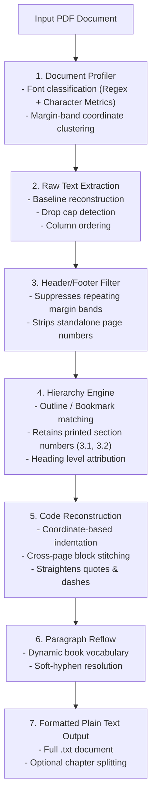

# PDF Book to Text Extractor (`pdf_book_to_text.py`)

A high-fidelity, layout-aware command-line tool designed to extract technical and programming PDF books into clean, well-structured plain text (`.txt`).

---

## Table of Contents

1. [Overview](#1-overview)
2. [Why Standard Tools Fail on Programming Books](#2-why-standard-tools-fail-on-programming-books)
3. [Key Features](#3-key-features)
4. [Installation & Requirements](#4-installation--requirements)
5. [Quick Start](#5-quick-start)
6. [Step-by-Step Usage Guide](#6-step-by-step-usage-guide)
   * [Step 1: Basic Single-Book Extraction](#step-1-basic-single-book-extraction)
   * [Step 2: Splitting by Chapters](#step-2-splitting-by-chapters)
   * [Step 3: Extracting Specific Pages](#step-3-extracting-specific-pages)
   * [Step 4: Batch Processing Multiple Books](#step-4-batch-processing-multiple-books)
   * [Step 5: Formatting for LLMs and Text-to-Speech](#step-5-formatting-for-llms-and-text-to-speech)
7. [Complete CLI Options Reference](#7-complete-cli-options-reference)
8. [Architecture & How It Works](#8-architecture--how-it-works)
9. [Troubleshooting & FAQ](#9-troubleshooting--faq)

---

## 1. Overview

Extracting plain text from PDF books usually results in broken sentences, interleaved page headers, dropped section numbers, and mangled code blocks. 

**`pdf_book_to_text.py`** was built specifically to solve these problems for technical books (Python, C++, Rust, JavaScript, DevOps, Systems Architecture, etc.). It treats the document as an engineered layout rather than a flat stream of characters, delivering publication-grade plain text ready for reading, archiving, or LLM indexing (RAG pipelines).

---

## 2. Why Standard Tools Fail on Programming Books

| Common Issue | Standard Tools (`pdftotext`, `pypdf`) | `pdf_book_to_text.py` Solution |
| :--- | :--- | :--- |
| **Code Indentation** | Strips leading spaces or misaligns columns | Reconstructs exact column alignment from character glyph positions |
| **Typographic Quotes** | Leaves curly quotes (`“` `”` `’`) that cause syntax errors | Automatically converts to straight ASCII quotes (`"`, `'`) and hyphens (`-`) |
| **Running Headers** | Interleaves chapter titles & page numbers into code blocks | Detects margin coordinate bands and suppresses repeating headers |
| **Broken Code Listings** | Treats page breaks as independent text | Automatically detects and re-joins continuous code across page breaks |
| **Section Numbers** | Loses prefixes like `3.1`, `3.2` during outline matching | Retains full printed section numbering from visual page layout |
| **Soft Hyphenation** | Leaves trailing hyphens (`execu-` / `tion`) | Verifies compounds against a book-specific vocabulary to repair words |

---

## 3. Key Features

* **Authoritative Chapter Hierarchy**: Uses PDF bookmarks (Table of Contents) as ground truth, formatted with clean underline styles:
  * Level 1: `====================` (Chapter Title)
  * Level 2: `--------------------` (Section)
  * Level 3: `~~~~~~~~~~~~~~~~~~~~` (Subsection)
  * Level 4: `» Subsection` (Minor Header)
* **Dual-Tier Monospace Detection**: Combines regex font-family matching with mathematical character-width variance analysis. Even proprietary or unusual monospace fonts (e.g. `mplus1mn`, `DejaVu`, `Cascadia`, `JetBrains`) are detected with 100% precision.
* **Code Block Fencing**: Wraps code listings in Markdown ``` fences by default (or 4-space indent / plain via `--code-style`).
* **Intelligent Paragraph Reflow**: Reassembles wrapped lines into flowing paragraphs without corrupting bullet points (`•`, `-`, `*`) or numbered lists (`1.`, `a.`).
* **Chapter Splitting (`--split-chapters`)**: Produces both the complete text and a separate folder with individual files for each chapter (e.g., `01 - Preface.txt`, `02 - Chapter 1: Introduction.txt`).
* **Table & Figure Support**: Optional ruled table extraction to ASCII grids (`--tables`) and image placeholders (`--figures`).
* **OCR Fallback**: Optional OCR via Tesseract (`--ocr`) for scanned or image-only pages.

---

## 4. Installation & Requirements

### System Requirements
* Python 3.10 or higher
* Linux, macOS, or Windows

### Step 1: Clone or Place the Script
Place [`pdf_book_to_text.py`](pdf_book_to_text.py) in your desired working folder (e.g. `~/Desktop/scripts/`).

### Step 2: Set Up Virtual Environment (Recommended)
```bash
# Navigate to the script directory
cd ~/Desktop/scripts

# Create a virtual environment
python3 -m venv .venv

# Activate the virtual environment
# On Linux/macOS:
source .venv/bin/activate
# On Windows (cmd):
# .venv\Scripts\activate.bat
# On Windows (PowerShell):
# .venv\Scripts\Activate.ps1
```

### Step 3: Install Dependencies
Install the required dependency (`pymupdf`):
```bash
pip install -r requirements.txt
```
*(Or directly: `pip install pymupdf`)*

---

## 5. Quick Start

### 1. Interactive Mode
Run the script without arguments and paste your PDF path when prompted:
```bash
python3 pdf_book_to_text.py
```
```text
Enter the path to a PDF book (or a folder of PDFs): /path/to/my_book.pdf
```

### 2. Single Command Extraction
```bash
python3 pdf_book_to_text.py my_book.pdf
```
This generates `my_book.txt` right next to the PDF file.

---

## 6. Step-by-Step Usage Guide

### Step 1: Basic Single-Book Extraction
Extract a PDF book with standard formatting (100-character line wrap, fenced code blocks, table of contents header):
```bash
python3 pdf_book_to_text.py book.pdf -o output_book.txt
```

### Step 2: Splitting by Chapters
When working with large textbooks, you often need individual chapter files:
```bash
python3 pdf_book_to_text.py book.pdf --split-chapters
```
**Output structure:**
```text
book.txt                        <-- Full book in a single text file
book_chapters/                  <-- Directory containing separated chapters:
  ├── 00 - Front Matter.txt
  ├── 01 - Preface.txt
  ├── 02 - Chapter 1: Introduction.txt
  ├── 03 - Chapter 2: Data Structures.txt
  └── ...
```

### Step 3: Extracting Specific Pages
Target specific sections or test a page range before extracting a 1,000-page book:
```bash
# Extract pages 10 through 45
python3 pdf_book_to_text.py book.pdf --pages 10-45

# Extract non-contiguous ranges
python3 pdf_book_to_text.py book.pdf --pages 1-15,30-40,88
```

### Step 4: Batch Processing Multiple Books
Convert an entire library or folder recursively:
```bash
# Convert every PDF in ~/Books and write outputs to ~/Extracted/
python3 pdf_book_to_text.py ~/Books/ -r -o ~/Extracted/
```

### Step 5: Formatting for LLMs and Text-to-Speech
If you are ingesting text into a Large Language Model (RAG / vector search) or an audio reader, you usually want **unwrapped paragraphs** (each paragraph on exactly one continuous line) with page indicators:
```bash
python3 pdf_book_to_text.py book.pdf -w 0 --page-markers
```
* `-w 0`: Disables paragraph line wrapping (code blocks remain intact with original formatting).
* `--page-markers`: Adds `[Page N]` indicators so you can trace citations back to the source PDF.

---

## 7. Complete CLI Options Reference

```text
usage: pdf_book_to_text.py [-h] [-o OUTPUT] [-r] [-w WIDTH]
                           [--code-style {fence,indent,plain}] [--pages PAGES]
                           [--page-markers] [--no-contents]
                           [--contents-depth CONTENTS_DEPTH] [--keep-headers]
                           [--columns {auto,1,2}] [--tables] [--figures]
                           [--ocr] [--ocr-lang OCR_LANG] [--password PASSWORD]
                           [--split-chapters] [--ignore-bookmarks]
                           [--keep-code-quotes] [--mark-inline-code] [-q]
                           [--version]
                           [inputs ...]
```

### Argument Details

| Flag | Default | Description |
| :--- | :---: | :--- |
| `inputs` | Prompt | PDF file(s) or folder path(s). |
| `-o`, `--output` | `<input>.txt` | Destination file (for single PDF) or folder (for multiple PDFs). |
| `-r`, `--recursive` | `False` | Recursively discover all `.pdf` files in subdirectories. |
| `-w`, `--width` | `100` | Paragraph wrap width (`0` disables wrapping; code blocks are never wrapped). |
| `--code-style` | `fence` | Format for code blocks: `fence` (```` ``` ````), `indent` (4 spaces), or `plain`. |
| `--pages` | All | Page range(s) (e.g. `'1-50'`, `'10-25,40-'`). |
| `--split-chapters` | `False` | Generates a folder with individual `.txt` files per chapter. |
| `--page-markers` | `False` | Inserts `[Page N]` markers to track physical PDF page locations. |
| `--no-contents` | `False` | Omits the generated Table of Contents block at the beginning. |
| `--contents-depth` | `3` | Maximum nesting depth for the Table of Contents header (1 to 4). |
| `--keep-headers` | `False` | Disables suppression of running headers, footers, and page numbers. |
| `--columns` | `auto` | Column mode: `auto` (detects 1 vs 2 columns), `1` (force single), `2` (force two). |
| `--tables` | `False` | Detects grid tables and renders them as ASCII text boxes. |
| `--figures` | `False` | Inserts `[Figure]` markers where significant images are placed. |
| `--ocr` | `False` | Applies OCR on pages without an embedded text layer (requires Tesseract). |
| `--ocr-lang` | `eng` | Tesseract language code (e.g. `eng`, `eng+deu`, `fra`). |
| `--password` | `None` | Password for encrypted/protected PDFs. |
| `--ignore-bookmarks` | `False` | Skips PDF bookmarks; infers headings exclusively from font metrics. |
| `--keep-code-quotes` | `False` | Prevents straightening of curly quotes/dashes inside code listings. |
| `--mark-inline-code` | `False` | Wraps inline monospace terms within body text in `` `backticks` ``. |
| `-q`, `--quiet` | `False` | Suppresses progress output and extraction summaries. |

---

## 8. Architecture & How It Works



### Extraction Pipeline

1. **Font & Character Metric Profiling**:
   Before reading lines, the extractor samples glyphs across the document. In proportional fonts, the letter `m` is roughly 3× wider than `i`. In monospace fonts, `m` and `i` share identical widths. The tool measures character variance to classify code fonts with zero false positives.

2. **Dominant Margin-Band Filtering**:
   Rather than relying only on text repetition (which fails when section names change on alternate pages), the extractor calculates the dominant `y`-coordinate bands for the top and bottom margins across all pages. Lines in those bands with body-sized text are identified as running headers/footers and excluded.

3. **Bookmark Alignment & Section Number Preservation**:
   PDF bookmarks often store bare titles (`Function calls`), whereas the printed page reads `3.1 Function calls`. The matcher aligns the bookmark entry with the printed layout and retains the full numbered heading.

4. **Code Block Alignment**:
   Monospace spans are mapped to character coordinate offsets. Instead of guessing indentation, spaces are computed as:
   $$\text{indentation\_spaces} = \text{round}\left(\frac{x_0 - x_{\text{left}}}{\text{char\_width}}\right)$$
   This ensures multi-column code alignments and nested indentation remain intact.

---

## 9. Troubleshooting & FAQ

### Q: Why are some pages missing text?
* **Cause**: The PDF may be a scanned document (images with no embedded text layer).
* **Fix**: Use the `--ocr` flag:
  ```bash
  python3 pdf_book_to_text.py book.pdf --ocr
  ```
  *(Note: Requires Tesseract OCR installed on your system: `sudo apt install tesseract-ocr` on Ubuntu/Debian).*

### Q: My book has 2 columns, but text is being read across columns.
* **Fix**: Force two-column detection:
  ```bash
  python3 pdf_book_to_text.py book.pdf --columns 2
  ```

### Q: How do I disable paragraph line wrapping for RAG / LLM chunking?
* **Fix**: Use `-w 0`:
  ```bash
  python3 pdf_book_to_text.py book.pdf -w 0
  ```
  This outputs every paragraph as a single continuous line, making it ideal for embedding models and vector chunkers.

### Q: How do I preserve inline code in backticks?
* **Fix**: Pass `--mark-inline-code`:
  ```bash
  python3 pdf_book_to_text.py book.pdf --mark-inline-code
  ```
  Inline terms like `int()`, `def`, or variable names will be enclosed in `` `backticks` `` in the output text.

---

## License & Commercial Inquiries

Copyright (c) 2026 **AZZANI**.
* Free for personal, academic, and non-commercial open-source use under the [PolyForm Noncommercial License](LICENSE).
* For commercial licensing or enterprise use, contact `info@7azzani.com` / `agz97agz97@gmail.com`.
* Official GitHub: [https://github.com/7AZZANI](https://github.com/7AZZANI)
* See the full [`LICENSE`](LICENSE) for complete terms.
