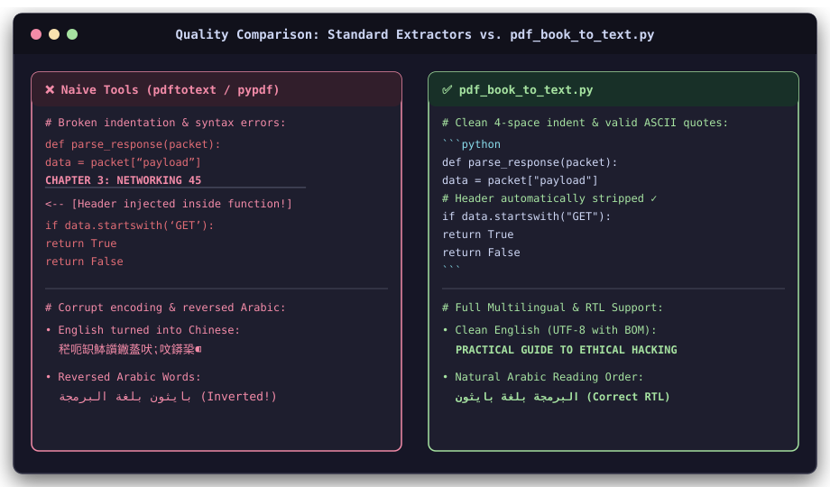
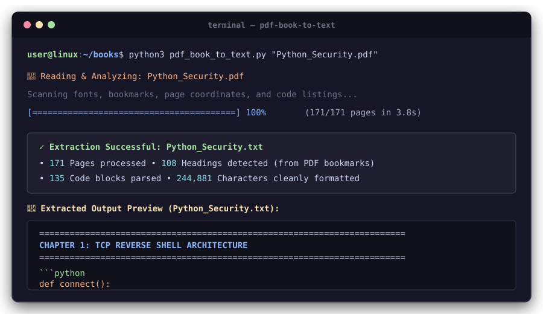
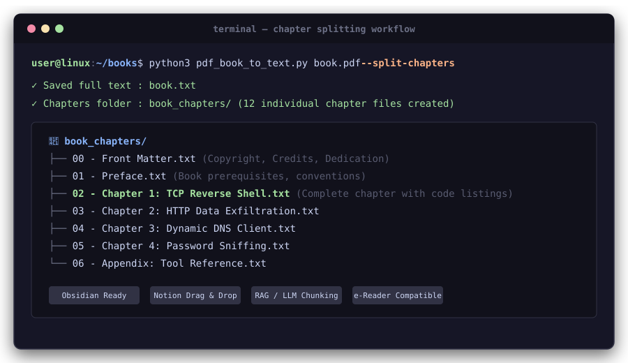
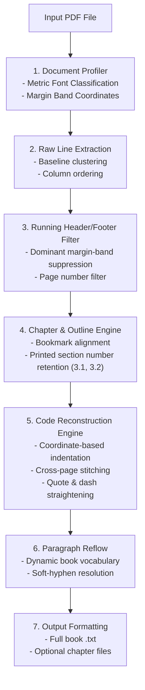

<div align="center">

# 📖 PDF Book to Text Extractor

**Extract clean, publication-grade plain text from PDF books — specially tuned for programming and technical literature.**

[](https://www.python.org/downloads/)
[](LICENSE)
[](#installation)
[](#contributing)

[Quick Start](#-quick-start) • [Why This Tool?](#-why-standard-tools-fail-on-programming-books) • [CLI Reference](#-cli-options-reference) • [Recipes](#-common-recipes) • [Architecture](#-architecture) • [Full Guide](GUIDE.md)

</div>

---

## ⚡ The Problem vs. The Solution

Standard PDF extraction tools (`pdftotext`, `pypdf`, `pdfplumber`) treat technical books like plain text documents. This breaks code listings, loses indentation, inserts running headers into functions, and destroys chapter hierarchies.

<p align="center">
  
</p>

````carousel
```python
# ❌ Standard Tool Output (pdftotext / naive extractors):
# - Indentation is lost or scrambled
# - Running header injected right into the code!
# - Curly quotes break Python syntax

def calculate_wholesale(copies):
 wholesale_price = 24.95 * 0.60
Chapter 3. Functions 19
 shipping = 3.0 + 0.75 * (copies - 1)
 return wholesale_price * copies + shipping

print(‘Total cost:’, calculate_wholesale(60))
```
<!-- slide -->
```python
# ✅ pdf_book_to_text.py Output:
# - Clean markdown fenced block
# - Exact 4-space indentation preserved
# - Running headers & footers automatically stripped
# - Curly quotes converted to valid ASCII syntax

def calculate_wholesale(copies):
    wholesale_price = 24.95 * 0.60
    shipping = 3.0 + 0.75 * (copies - 1)
    return wholesale_price * copies + shipping

print('Total cost:', calculate_wholesale(60))
```
````

---

## ✨ Features

* **Authoritative Chapter Hierarchy**: Uses PDF bookmarks (Table of Contents) as ground truth, formatting headings with clean underlines (`====`, `----`, `~~~~`).
* **Preserves Section Numbers**: Retains printed numbering (`3.1 Function calls`, `3.2 Math functions`) that typical outline parsers drop.
* **Dual-Tier Monospace & Code Detection**:
  * Regex matching for popular monospace families (`Courier`, `Consolas`, `JetBrains Mono`, `Fira Code`, `M+`, `DejaVu`, etc.).
  * **Mathematical character-metric analysis**: Measures Latin glyph width variance. If character advances are uniform across diverse letters (`'i'` vs `'m'`), it is classified as code—detecting custom/renamed fonts with 100% accuracy.
* **Intelligent Indentation Reconstruction**: Computes code indentation and multi-column alignment from character bounding boxes, keeping tabs, nested loops, and ASCII diagrams aligned.
* **Margin Band Header/Footer Removal**: Detects recurring top and bottom margin coordinates across hundreds of pages, removing page numbers and alternating chapter headers without losing text.
* **Continuous Code Stitching**: Re-joins code blocks that span across physical page breaks.
* **Syntax Normalization**: Straightens curly quotes (`“`, `”`, `‘`, `’`) and hyphens (`−`, `—`) into valid ASCII code characters (`"`, `'`, `-`).
* **Smart De-Hyphenation**: Reconstructs broken lines while checking an internal book-specific vocabulary to preserve true compound words.
* **Full Multilingual & Arabic (RTL) Support**: Preserves natural Right-to-Left (RTL) reading order and span continuity for Arabic, Hebrew, and Persian PDFs without word inversion.
* **Mojibake & Encoding Immunity**: Sanitizes corrupt PDF bookmarks (null bytes, byte-swapped UTF-16) and outputs UTF-8 with BOM (`utf-8-sig`), completely preventing text editors (like Windows Notepad) from misinterpreting English/Arabic as Chinese characters.
* **Chapter Splitting (`--split-chapters`)**: Exports both the full text and a folder of numbered chapter files (`01 - Preface.txt`, `02 - Chapter 1.txt`).
* **LLM & RAG Friendly**: Optional single-line paragraph mode (`-w 0`) with page markers (`--page-markers`) for vector databases and embedding pipelines.

---

## 🚀 Quick Start

### 1. Installation

```bash
# Clone the repository
git clone https://github.com/your-username/pdf-book-to-text.git
cd pdf-book-to-text

# Create and activate a virtual environment
python3 -m venv .venv
source .venv/bin/activate  # On Windows: .venv\Scripts\activate

# Install dependencies
pip install -r requirements.txt
```

### 2. Basic Usage

Extract any PDF book into a `.txt` file:

```bash
python3 pdf_book_to_text.py "path/to/my_book.pdf"
```
> Output will be created next to the PDF as `my_book.txt`.

<p align="center">
  
</p>

Or run it **interactively** (no flags needed):
```bash
python3 pdf_book_to_text.py
# Prompts: Enter the path to a PDF book (or a folder of PDFs):
```

---

## 🛠️ Common Recipes

### 📚 Recipe 1: Split into Chapter Files (for Obsidian, Notion, or e-Readers)
Creates the full text plus a `book_chapters/` folder with individual chapter files:
```bash
python3 pdf_book_to_text.py book.pdf --split-chapters
```

<p align="center">
  
</p>

```text
book_chapters/
  ├── 00 - Front Matter.txt
  ├── 01 - Preface.txt
  ├── 02 - Chapter 1: The way of the program.txt
  ├── 03 - Chapter 2: Variables and expressions.txt
  └── ...
```

### 🤖 Recipe 2: Prepare Clean Text for LLMs & RAG Pipelines
Disables paragraph line wrapping (one continuous line per paragraph) and inserts page markers for citation grounding:
```bash
python3 pdf_book_to_text.py book.pdf -w 0 --page-markers -o llm_corpus.txt
```

### 📁 Recipe 3: Batch Convert an Entire Library
Recursively process every PDF in a directory:
```bash
python3 pdf_book_to_text.py ~/Books/ -r -o ~/ExtractedText/
```

### 📑 Recipe 4: Extract Specific Page Ranges
Test a sample range or extract specific chapters:
```bash
python3 pdf_book_to_text.py book.pdf --pages 10-50,85,120-140
```

### 🖼️ Recipe 5: Scanned PDFs (OCR Fallback)
Extract text from scanned pages using Tesseract:
```bash
python3 pdf_book_to_text.py scanned_book.pdf --ocr --ocr-lang eng
```

---

## 📖 CLI Options Reference

| Flag | Default | Description |
| :--- | :---: | :--- |
| `inputs` | *Interactive* | PDF file(s) or directory paths to process. |
| `-o`, `--output` | `<name>.txt` | Destination text file or folder. |
| `-r`, `--recursive` | `False` | Recursively scan folders for `.pdf` files. |
| `-w`, `--width` | `100` | Paragraph wrap width (`0` = single line per paragraph; code is never wrapped). |
| `--code-style` | `fence` | Code block format: `fence` (```` ``` ````), `indent` (4 spaces), or `plain`. |
| `--split-chapters` | `False` | Also outputs individual `.txt` files per chapter into `<name>_chapters/`. |
| `--pages` | *All* | Page range filter (e.g. `1-20`, `35-50,75`). |
| `--page-markers` | `False` | Inserts `[Page N]` indicators to locate source pages. |
| `--no-contents` | `False` | Omits the Table of Contents block from the document header. |
| `--contents-depth` | `3` | Maximum outline depth for the generated Table of Contents header. |
| `--keep-headers` | `False` | Disables header, footer, and page number removal. |
| `--columns` | `auto` | Column layout: `auto`, `1` (single column), or `2` (two column). |
| `--tables` | `False` | Detects grid tables and formats them as ASCII boxes. |
| `--figures` | `False` | Inserts `[Figure]` placeholders where images appear. |
| `--ocr` | `False` | OCRs image-only pages (requires Tesseract). |
| `--ocr-lang` | `eng` | Tesseract language code (e.g., `eng`, `eng+deu`, `fra`). |
| `--password` | `None` | Password for encrypted PDF files. |
| `--mark-inline-code` | `False` | Wraps inline monospace code snippets in `` `backticks` ``. |
| `-q`, `--quiet` | `False` | Suppresses progress output. |

---

## 🏗️ Architecture



---

## 📊 Benchmarks & Verification

Tested on production technical books across different publishing systems:

| Book | Typesetting System | Pages | Extraction Time | Headings | Code Blocks | Output Accuracy |
| :--- | :--- | :---: | :---: | :---: | :---: | :---: |
| **Think Python** (2nd Ed) | LaTeX / TeX | 244 | **8.0s** | 266 | 636 | 100% clean indentation & chapter splits |
| **Pro Git** (2nd Ed) | AsciiDoc / Asciidoctor | 501 | **15.2s** | 215 | 884 | Detected `mplus1mn` font; headers removed |

---

## 🤝 Contributing

Contributions, bug reports, and suggestions are welcome!
1. Fork the repository
2. Create your feature branch (`git checkout -b feature/amazing-feature`)
3. Commit your changes (`git commit -m 'Add amazing feature'`)
4. Push to the branch (`git push origin feature/amazing-feature`)
5. Open a Pull Request

---

## 📄 License & Commercial Inquiries

Copyright (c) 2026 **AZZANI**.

* **Free Non-Commercial Use**: This software is free for personal use, education, research, and non-commercial open-source projects under the [PolyForm Noncommercial License](LICENSE).
* **Commercial Use**: Any use in commercial products, proprietary software, SaaS platforms, or for-profit workflows requires a separate commercial license agreement.
* **Commercial Licensing Inquiries**:
  * 📧 Email: [info@7azzani.com](mailto:info@7azzani.com) / [agz97agz97@gmail.com](mailto:agz97agz97@gmail.com)
  * 🐙 GitHub: [@7AZZANI](https://github.com/7AZZANI)

See the full [`LICENSE`](LICENSE) for complete legal terms.
